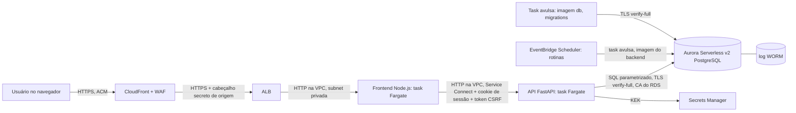
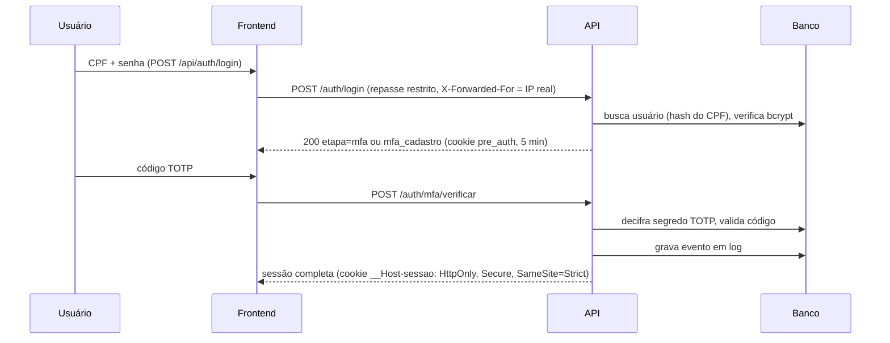

# ARCHITECTURE: CyberSec Saúde

Versão: 0.1 | Relacionado: `SPEC.md`, `THREAT_MODEL.md`, `/docs/adr`

## 1. Contexto
Sistema web para [descrever: ex. gestão de prontuários/consultas] com dados de saúde (sensíveis pela LGPD, art. 5º, II). Prioridades: confidencialidade, integridade e rastreabilidade.

## 2. Visão geral (C4: containers)

Implantação na AWS (ADR-0029):



| Componente | Tecnologia | Responsabilidade |
|---|---|---|
| Borda | CloudFront + ALB (ACM) | Único ponto exposto: TLS na entrada, redirecionamento de HTTP, timeouts e IP real do cliente (`CloudFront-Viewer-Address`) (ADR-0029) |
| Frontend | Node.js | Telas, fluxo de login/MFA, headers de segurança (CSP, HSTS, Trusted Types) e repasse restrito `/api` para a API, com checagem de origem (ADR-0012, ADR-0013) |
| Backend | Python 3.14 + FastAPI | Regras de negócio, autenticação, MFA, criptografia, auditoria, token CSRF e limite por IP |
| Tarefas | Python (mesma imagem do backend), EventBridge Scheduler | Limpeza de sessões e contadores, verificação periódica da cadeia do log (ADR-0013, ADR-0029) |
| Migrations | Imagem `db/` (Alembic) | Migrations, bootstrap das roles e importação do CID, como task avulsa (ADR-0029) |
| Banco | Aurora Serverless v2 PostgreSQL (AWS); PostgreSQL 18 no Docker (dev) | Persistência, triggers WORM, permissões por role |
| Chaves | Secrets Manager (AWS); `.env` (dev) | Guarda a KEK que cifra as DEKs |

## 3. Camadas do backend

```
rotas (routers)  ->  serviços  ->  repositórios  ->  banco
      |                 |
   validação        regras de negócio, cripto, auditoria
   (Pydantic)
```
- **Rotas:** só recebem/validam entrada e devolvem resposta. Sem lógica de negócio.
- **Serviços:** autenticação, MFA, criptografia, auditoria, regras do domínio.
- **Repositórios:** único ponto de acesso ao banco (queries parametrizadas/ORM).

Estrutura sugerida:
```
backend/app/
  api/         # routers
  core/        # config, segurança, dependências
  services/    # auth, mfa, crypto, audit
  repositories/
  models/      # tabelas
  schemas/     # Pydantic
  tests/
```

## 4. Fluxo de autenticação com MFA


Regras (ADR-0002, 0008, 0009): token temporário só vale para a etapa MFA; sessão expira com 15 min sem uso e 8 h no máximo; rate limit e bloqueio progressivo nas duas etapas; códigos de recuperação de uso único, armazenados com hash. Com a sessão completa, toda escrita exige o token CSRF, entregue por `GET /auth/sessao` (ADR-0013).

## 5. Criptografia de dados sensíveis (envelope encryption)

- **Dado sensível** é cifrado com uma **DEK** (AES-256-GCM, nonce único por registro).
- A **DEK** é cifrada com a **KEK** e guardada junto do registro (`dek_encrypted`).
- A **KEK** nunca fica no banco: vem de variável de ambiente (dev) ou secret manager (produção).
- Para buscar por campo cifrado (ex.: e-mail), usar **hash determinístico com chave (HMAC-SHA256)** em coluna separada.
- Rotação: trocar a KEK exige apenas recifrar as DEKs, não os dados (`rewrap`).
- Cada campo é cifrado com AAD (tabela, coluna, id do registro): valor movido de registro não decifra.
- Implementação: `backend/app/core/crypto.py`; detalhes e alternativas no ADR-0004.

| Dado | Proteção |
|---|---|
| Senha | bcrypt com salt, custo >= 12 (hash, não é cifrado) |
| Segredo TOTP | AES-256-GCM |
| Dados de saúde (CPF, diagnóstico, etc.) | AES-256-GCM por campo |
| Códigos de recuperação | Hash |
| Em trânsito | TLS até a borda (CloudFront/ALB) e até o banco; HTTP só dentro da VPC (ADR-0029) |

## 6. Log de auditoria WORM

- Tabela `log` (schema `app`) **append-only**: triggers bloqueiam `UPDATE`, `DELETE` e `TRUNCATE`.
- Role da aplicação (`app_user`) com **apenas INSERT e SELECT** na tabela. Migrations rodam com outra role.
- **Hash encadeado** (ADR-0010): a trigger `log_encadear` calcula `hash = SHA-256(prev_hash + conteúdo)` sob lock, na ordem de `seq_cadeia`. Alterar um registro quebra todos os seguintes.
- **Verificação da cadeia:** `scripts.verificar_log` recalcula tudo em Python (sem confiar na função do banco). O container `tarefas` executa a verificação a cada hora, e a tela de auditoria mostra o último resultado.
- **Consulta:** só leitura, com permissão `log:ler` (Auditor e Administrador), filtros por data, usuário e evento e leitura auditada (ADR-0015). O log guarda só hashes; para o Administrador, o CPF vem dos cadastros, decifrado na hora de responder, e o Auditor vê o hash (ADR-0016, ADR-0017).
- **Checkpoints assinados** (`log_checkpoint`, HMAC com chave fora do banco) e **âncora** impressa para guardar fora do sistema: revelam a remoção do fim do log.
- Opcional (nível avançado): exportar periodicamente para armazenamento com *object lock*.
- Nenhum dado sensível dentro do log.

Esquema base:
```
log(id_log, data_hora, acao, resumo_acessado, ip_origem, request_id, geolocalizacao, cpf_usuario_hash, cpf_paciente_hash, id_oci, seq_cadeia, prev_hash, hash_assinatura_worm)
log_checkpoint(id_checkpoint, criado_em, seq_cadeia, hash_cadeia, assinatura)
```

## 7. Controle de acesso
RBAC com perfis (usuário, profissional, administrador, auditor). Verificação **sempre no backend**, a cada requisição. Auditor tem somente leitura dos logs. Administrador não lê dados de saúde sem registro de auditoria.

Implementação (ADR-0011): usuário → `usuario_grupo` → `grupo_papel` → `papel_permissao` → permissão (todos ativos), checada pela dependência `exigir(permissao)` em cada rota, sem cache. Perfis iniciais: Administrador, Gestor, Gestor do Cuidado, Navegador e Auditor; atribuição por `scripts.atribuir_grupo` (evento `role_change`). Negativas geram `access_denied`. Pacientes são acessados por UUID opaco (`id_publico`); o CPF só trafega no corpo da busca.

## 8. Implantação
- **Módulos** (ADR-0029): `frontend/`, `backend/` e `db/`, cada um com a própria imagem. Todas usam usuário não-root, sistema de arquivos somente leitura e nenhuma capability.
- **AWS:**
  - CloudFront e ALB terminam o TLS (ACM);
  - frontend e backend são serviços ECS Fargate em subnets privadas: o ALB só alcança o frontend, e só o frontend alcança o backend (security groups);
  - Aurora Serverless v2 com `rds.force_ssl=1`, acessado com `verify-full` e a CA do RDS embutida nas imagens;
  - rotinas pelo EventBridge Scheduler e migrations como task avulsa.
  
  Requisitos de infraestrutura e variáveis por task estão no ADR-0029.
- **Desenvolvimento** (`docker compose up`):
  - `db` (Postgres 18, porta 127.0.0.1:5433, TLS obrigatório com certificado efêmero gerado no container), `backend`, `tarefas` e `frontend` (`http://localhost:3000`);
  - as redes `api` e `dados` são internas: o frontend não alcança o banco;
  - migrations com `docker compose run --rm migrar`.
- **Segredos:** Secrets Manager na AWS; `.env` fora do git em dev; `.env.example` versionado sem valores.

## 9. Decisões de arquitetura (ADRs a criar em `/docs/adr`)
| ADR | Decisão | Alternativa descartada |
|---|---|---|
| 001 | FastAPI como backend | Django |
| 002 | TOTP como segundo fator | SMS (vulnerável a SIM swap) |
| 003 | bcrypt com salt para senhas | Argon2id/PBKDF2 |
| 004 | Criptografia de campo com envelope | Só pgcrypto / disco cifrado |
| 005 | WORM por trigger + hash encadeado | Tabela comum com permissão |
| 006 | Postgres 18 em Docker | Instalação local |

## 10. Requisitos de qualidade
- Testes automatizados em auth, cripto e auditoria.
- Análise estática: `bandit`, `ruff`, `mypy`; dependências: `pip-audit`, `npm audit`.
- Teste dinâmico com OWASP ZAP na fase final.
